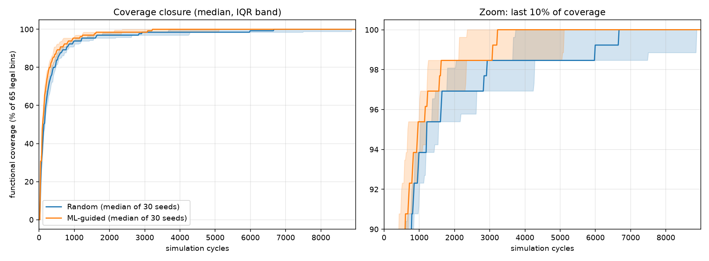

# ML-Guided Coverage Closure for a Pipelined RISC-V-Style Core (pure Verilog)

A 5-stage in-order pipelined core, a **self-checking** constrained-random testbench
(reference model + scoreboard + functional coverage), and a small decision-tree model that
learns which stimulus settings hit the *rarest* coverage bins.
Everything RTL/TB is plain **Verilog-2001** (`iverilog -g2001`, no SystemVerilog, no UVM).



## Measured results (30 held-out seeds, 600 tests each, 0 scoreboard errors)

Cycles until cumulative functional coverage first reaches X % of the 65 legal bins:

| target | random (median) | ML-guided (median) | median speed-up | Mann-Whitney p |
|---|---|---|---|---|
| 50 % | 136 | 110 | 1.23x | 3e-6 |
| 75 % | 330 | 236 | 1.40x | 7e-6 |
| 90 % | 770 | 589 | 1.31x | 0.001 |
| 95 % | 1206 | 944 | 1.28x | 0.006 |
| **100 %** | **6322** | **3134** | **2.02x** | 0.002 |

* Random reached 100 % in 29/30 seeds within the budget; guided in 30/30.
* Means to 100 %: 6473 vs 4034 cycles (1.6x) - the median is the more robust summary, the mean is shown for transparency.
* The rarest bins (back-to-back *same-address* memory pairs) are hit by **0.8-1.0 %** of random tests
  and **13-18 %** of guided tests.
* Full table: `results/summary.md`.

### Honest caveats
* The model is modest: 5-fold CV ROC-AUC = **0.70** (0.5 = chance). It is useful, not magic.
* Training data costs simulation: 198 k cycles (20 runs). Savings are ~2.9 k cycles per closure run, so the
  one-off cost is recovered after ~70 regression re-runs (in a real flow the data is free history from earlier regressions).
* Guidance is not uniformly better: the tree pushes BNE weight to ~0, so the `load-use-stall x BNE` bin became
  *less* likely under guided stimulus (0.055 -> 0.022). Closure still wins overall because of the other 13 rare bins.
* Tiny custom ISA, 16-bit datapath, 69 coverage slots (65 legal). This is a methodology demo, not a product core.

## What is in the box

```
rtl/core_defs.vh        opcode macros
rtl/pipeline_core.v     IF-ID-EX-MEM-WB core, PC + branch redirect, hazards, forwarding
tb/tb_core.v            program generator, ISA reference model, scoreboard, coverage monitor
scripts/run_flow.py     one-command flow (build -> train data -> model -> eval -> compare -> mutants)
scripts/train_coverage_model.py   decision tree on EXPLORE data, writes results/knobs.txt
scripts/compare_coverage.py       statistics + plot across seeds
results/                summary.md, model_report.txt, mutation_report.md, plot, raw per-seed CSVs
```

### The core
Custom 16-bit encoding `[15:12] op | [11:9] rd | [8:6] rs1 | [5:3] rs2 | [2:0] imm`:
`ADD SUB AND OR ADDI LW SW BEQ BNE` (+ NOP). r0 = 0, 8x16-bit regfile, 64x16-bit data memory.

| hazard | handling |
|---|---|
| load-use | 1-cycle stall (hold PC and IF/ID, bubble to ID/EX) |
| RAW distance 1 | EX/MEM -> EX forwarding (non-load producers only) |
| RAW distance 2 | MEM/WB -> EX forwarding (also carries load data) |
| RAW distance 3 | regfile write-through bypass in ID |
| branch | resolved in EX, redirects PC (forward-only offsets), squashes the 2 younger instructions |

### The testbench (per test)
1. Generate a 32-instruction random program. Knobs: 9 opcode weights, P(dependent operand), P(re-use memory address).
   Fields an instruction does not use are filled with random garbage on purpose.
2. Run it on a behavioural ISA reference model -> expected retirement trace and final state.
3. Run the DUT; every retired instruction (pc, rd, data, store addr/data) is compared in order; final regfile and
   data memory are compared; an invariant check guards the load-use logic.
4. Sample **functional coverage** (manual counters - Icarus has no `covergroup`): consumer opcode x forwarding path (32 legal bins),
   load-data forwarding, load-use stall x consumer opcode, branch outcome (with/without forwarded operand),
   regfile bypass, flush x squashed opcode, same-address memory back-to-back pairs.

### Checker validation (mutation testing)
`results/mutation_report.md` - six injected RTL bugs (`-DBUG_NO_STALL`, `NO_FWD_WB`, `NO_BYPASS`, `FLUSH_ONE`, `FWD_R0`,
`STORE_NOFWD`); the scoreboard flags **6/6** on every seed tried, while the clean design reports 0 errors.

### The ML loop
1. `BASELINE` runs measure how rare each bin is under pure random stimulus (rare = hit by < 10 % of tests -> 14 bins).
2. `EXPLORE` runs draw random knob vectors per test; label = "test hit >= 2 rare bins".
3. A `DecisionTreeClassifier(max_depth=4)` is trained on knobs -> label (interpretable rules in `results/model_report.txt`;
   top features: LW weight, P(dependent operand)).
4. The tree scores 50 000 candidate knob vectors; 16 vectors from the best leaf are written to `results/knobs.txt`.
5. `GUIDED` runs draw one of those vectors per test. Evaluation uses **different seeds** than training.

## Run it

Requirements: [Icarus Verilog](https://steveicarus.github.io/iverilog/) >= 11, Python 3.9+, `pip install -r requirements.txt`.

```bash
python scripts/run_flow.py            # full flow, ~2-3 min on one core
python scripts/run_flow.py --quick    # smoke test, ~20 s
python scripts/run_flow.py --steps mutants

# or by hand
iverilog -g2001 -I rtl -o build/sim.vvp rtl/pipeline_core.v tb/tb_core.v
vvp build/sim.vvp +MODE=BASELINE +SEED=1 +TESTS=500 +TESTS_CSV=results/t.csv +BINS_CSV=results/b.csv
```

## Design notes
* **Custom encoding, not RV32I** - the subject is hazard/forwarding/coverage methodology, not an ISA decoder.
* **Manual coverage counters** - Icarus Verilog has no `covergroup`; a commercial simulator would use covergroups + UCIS.
* **Decision tree, not a deeper model** - the rules are readable, which matters when you must justify why a bin is hard to hit.
* **Pure Verilog** - the random generator uses `$random(seed)` and plusargs; no SystemVerilog constraints or UVM.

## License
MIT - see [LICENSE](LICENSE)
